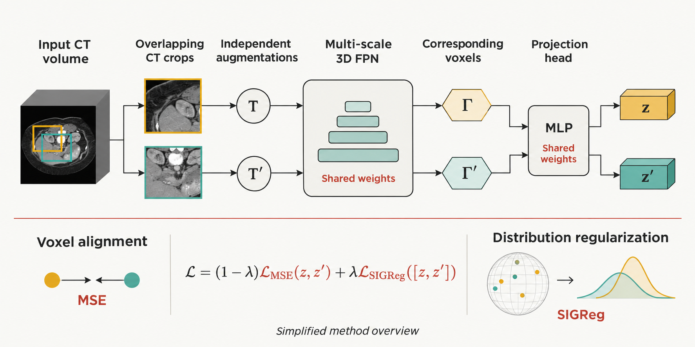
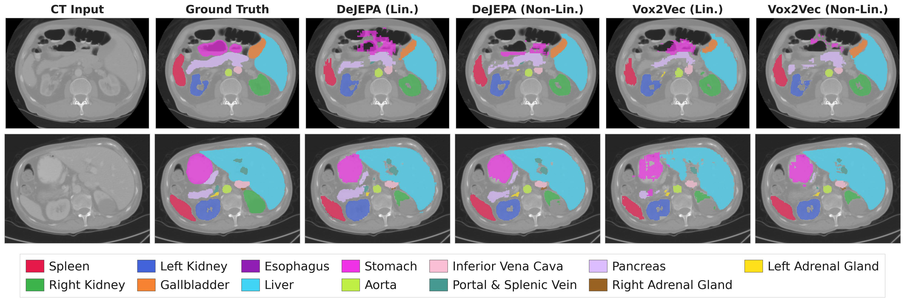

## Learning beyond the labels

Medical image annotations are expensive, while unlabelled scans are abundant. DeJEPA explores how to learn useful voxel-level representations from those unlabelled volumes, without contrastive negative pairs.

The framework combines independently augmented overlapping crops, a shared multi-scale 3D feature pyramid, and an objective that aligns corresponding voxel embeddings while regularizing their distribution. We evaluate the features with probing and fine-tuning on medical segmentation tasks.

*Simplified visual overview. [Open at full resolution](/images/research/dejepa-overview.png) · [Original figure from the paper](/images/research/dejepa-method.png)*

## Qualitative results

*Qualitative results from the DeJEPA paper. View the full paper for experimental conditions and quantitative comparisons.*

## Paper and implementation

**Aloys Portafaix and Samuel Kadoury** · MLMI, MICCAI 2026 Workshops

[Read the paper](https://papers.miccai.org/miccai-2026-sat/MLMI_011.html) · [Explore the implementation](https://github.com/aloyspx/De-JEPA)

The code covers preprocessing, self-supervised pretraining, linear and nonlinear probing, and fine-tuning. Dataset preparation and reproduction instructions are in the repository.
