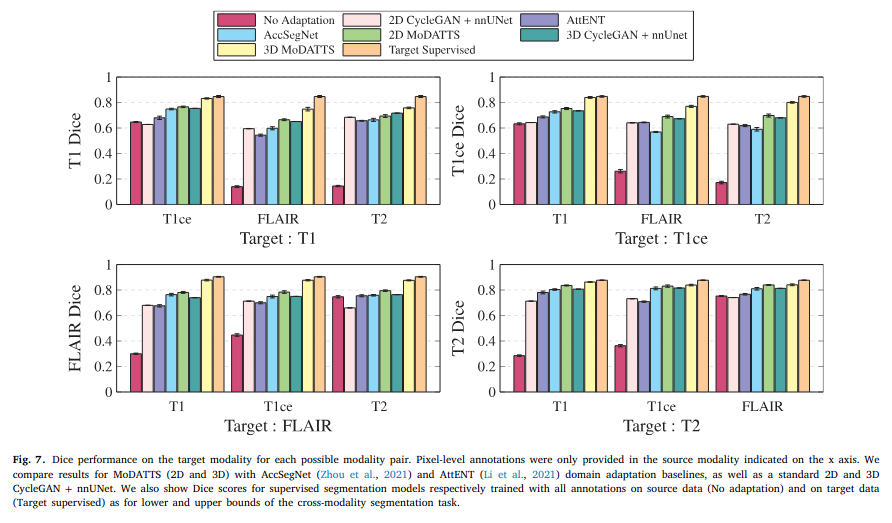

## Transferring what is already annotated

An accurate segmentation model in one modality may fail in another. MoDATTS studies this problem using image translation and self-training to make better use of existing annotations and unlabelled target images.

The framework combines transformer-based image translation and segmentation with an iterative self-training procedure. Image-level labels provide an additional source of supervision when detailed annotations are scarce.

## My contribution

I am a co-first author with Malo Alefsen de Boisredon d’Assier. My contribution included leading the rebuttal process, designing and conducting additional experiments, implementing comparative methods, and revising the manuscript.

The work was published in *Medical Image Analysis* in 2024.

[Read the paper](https://doi.org/10.1016/j.media.2024.103287) · [Related CycleGAN implementation](https://github.com/aloyspx/CycleGANs)
