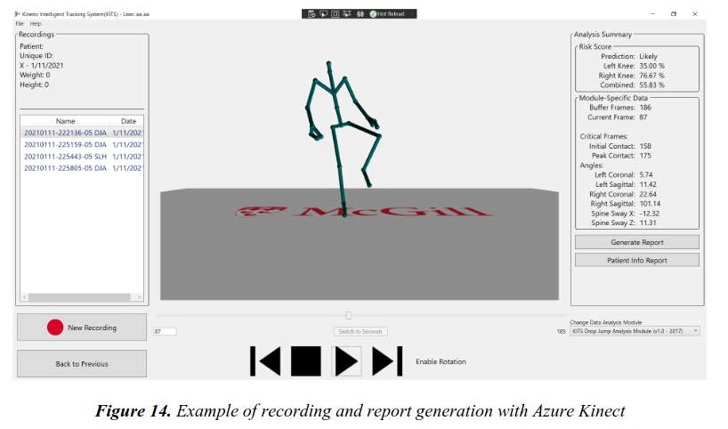

## From pose estimates to movement assessment

My undergraduate research focused on improving lower-limb tracking for athletic jump mechanics assessment. With Thomas Fevens, I studied ways to improve joint position estimates and reduce inference time, including real-time depth estimation and post-processing corrections.

I also developed a mobile assessment prototype and integrated the Azure Kinect into an existing orthopaedic movement assessment system, as part of my honours projects.

## A contribution to the work behind HurtBlocker

This research formed part of the wider effort behind **HurtBlocker**, a movement screening application. My role was a focused research contribution in Kinect integration and real-time joint depth estimation and correction, within a larger team effort.

HurtBlocker is available on the [App Store](https://apps.apple.com/ca/app/hurtblocker/id6747727133) and [Google Play](https://play.google.com/store/apps/details?id=ca.semperform.hurtblocker).

## Related research

[Improving Accuracy and Runtime of Skeletal Tracking of Lower Limbs for Athletic Jump Mechanics Assessment](https://doi.org/10.1109/EMBC46164.2021.9629726) · EMBC 2021

[Later work from the Kinect collaboration](https://pubmed.ncbi.nlm.nih.gov/36790216/)

The Kinect integration was subsequently completed by other members of the collaboration. The project code is not publicly available.
